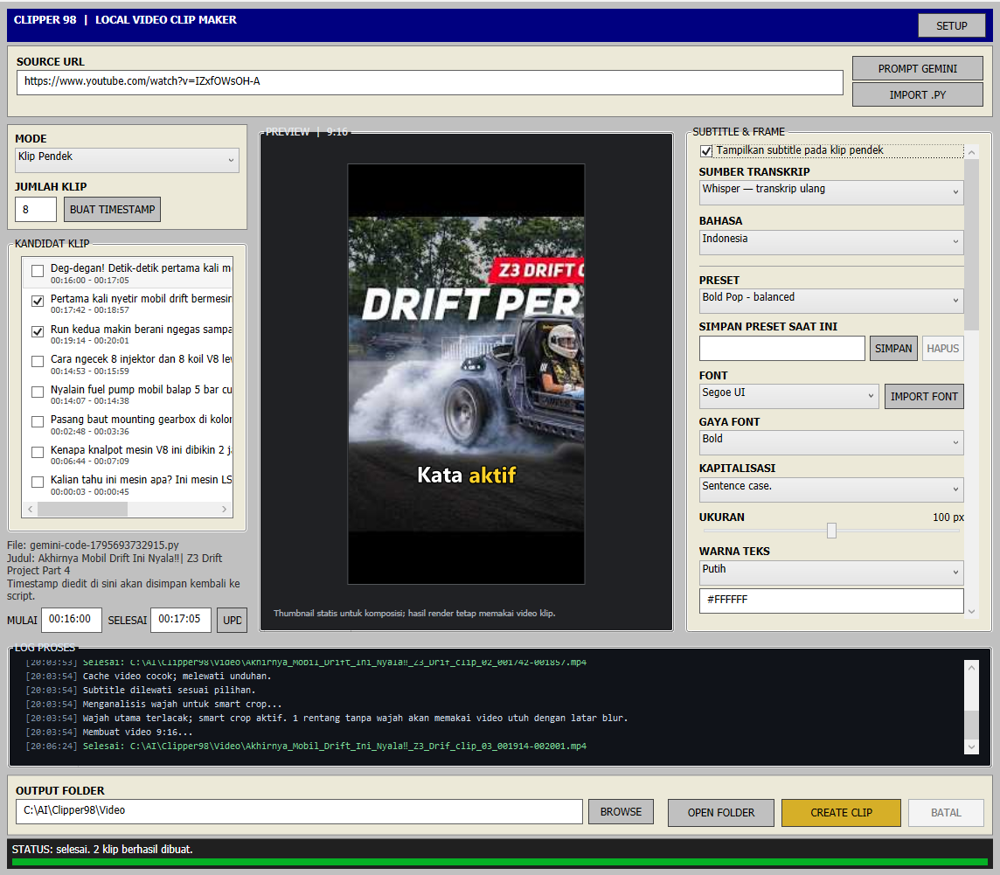
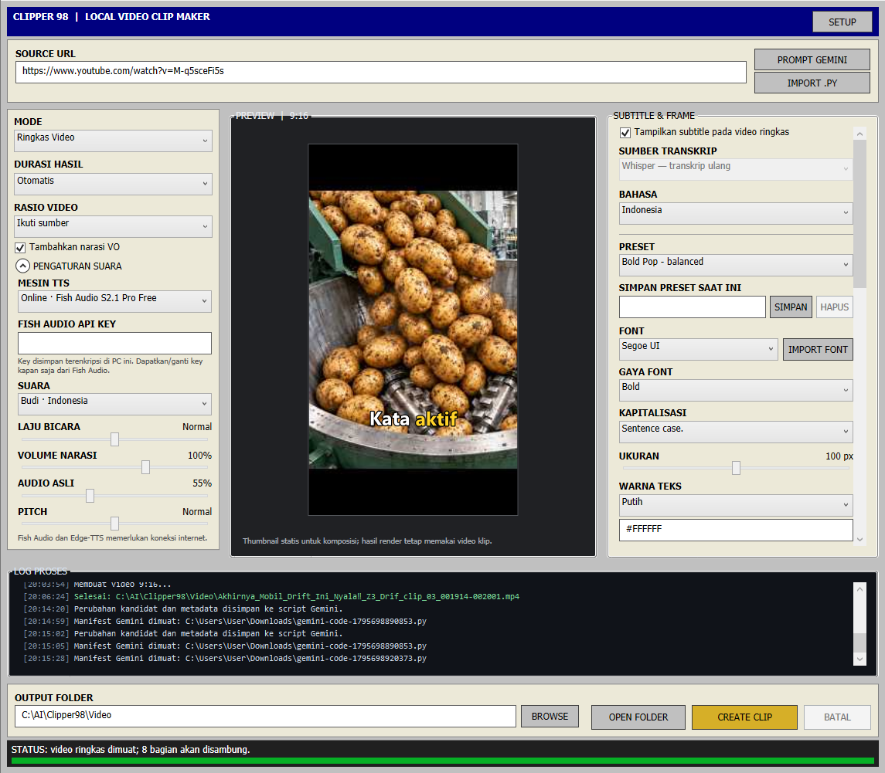

<h1 align="center">Clipper98</h1>

<p align="center"><strong>Buat klip pendek atau ringkas video YouTube langsung di Windows.</strong><br>
Pilih momen lewat Gemini CLI, impor manifest ke Clipper98, lalu unduh dan render videonya secara lokal.</p>

<p align="center">
  <a href="https://github.com/mnzrsyq/Clipper98/blob/main/installer/Clipper98.iss"></a>
  <a href="https://github.com/mnzrsyq/Clipper98/blob/main/Clipper98.csproj"></a>
</p>

<p align="center">
  <a href="#preview">Preview</a> · <a href="#fitur">Fitur</a> · <a href="#instalasi">Instalasi</a> · <a href="#cara-pakai">Cara pakai</a> · <a href="#konfigurasi">Konfigurasi</a> · <a href="#faq">FAQ</a> · <a href="#kontribusi">Kontribusi</a>
</p>

---

## Preview

<p align="center">
  <a href="screenshots/short-clips-mode.png"></a>
  <a href="screenshots/condense-mode.png"></a>
</p>

<p align="center">
  <sub><strong>Klip Pendek</strong> · pilih kandidat, subtitle, dan framing</sub>
  &nbsp;&nbsp;|&nbsp;&nbsp;
  <sub><strong>Ringkas Video</strong> · atur bagian, voice-over, dan subtitle</sub>
</p>

## Fitur

| Bagian | Yang tersedia |
| --- | --- |
| **Klip Pendek** | Impor beberapa kandidat dari manifest Gemini, periksa timestamp, pilih klip, lalu render satu per satu. |
| **Ringkas Video** | Susun satu video lebih pendek dari bagian-bagian yang dipertahankan di manifest. Target durasi bersifat perkiraan agar alur tetap utuh. |
| **Subtitle** | Gunakan subtitle YouTube atau transkripsi lokal Whisper Large-v3-Turbo. Subtitle dapat dimatikan untuk Klip Pendek maupun Ringkas Video. |
| **Framing** | Render vertikal 9:16, pertahankan rasio sumber, gunakan Smart Crop untuk mengikuti wajah, atau tambahkan frame PNG. Mode Ringkas Video juga menyediakan area isi 4:5 di kanvas 9:16. |
| **Tampilan subtitle** | Pilih font Windows, kapitalisasi, ukuran, warna, highlight kata, outline, jumlah baris, dan posisi. Simpan preset sendiri. |
| **Voice-over** | Tambahkan narasi pada Ringkas Video menggunakan Edge-TTS atau Fish Audio. Fish Audio memerlukan API key. |
| **Metadata YouTube** | Edit dan salin judul serta deskripsi untuk tiap klip. Clipper98 tidak mengunggah video ke YouTube. |
| **Cache lokal** | Gunakan ulang video, transkrip, analisis framing, dan audio narasi yang masih cocok. Cache bisa dibersihkan dari aplikasi. |

Gemini CLI atau Antigravity CLI membantu memilih momen dan membuat manifest. Clipper98 membaca file `.py` tersebut sebagai data sederhana; kode di dalam file tidak dijalankan.

## Instalasi

### Installer Windows

1. Buka [GitHub Releases](https://github.com/mnzrsyq/Clipper98/releases).
2. Unduh installer terbaru bernama `Clipper98-Setup-vX.Y.Z.exe`, lalu jalankan.
3. Buka Clipper98 dari Start Menu atau shortcut Desktop.
4. Saat pertama kali memakai fitur, buka **SETUP** dan pilih **UNDUH KOMPONEN KURANG**.

Installer ditujukan untuk **Windows x64** dan menyertakan runtime .NET yang diperlukan. Pengguna tidak perlu memasang .NET Runtime sendiri. Installer tidak menyertakan yt-dlp, Node.js, FFmpeg, whisper.cpp, atau model Whisper; Clipper98 mengunduh komponen yang diperlukan ke PC saat diminta. Model Whisper Large-v3-Turbo berukuran sekitar 1,5 GiB.

Perlu koneksi internet untuk mengunduh komponen dan video. Voice-over Fish Audio dan Edge-TTS juga memerlukan koneksi internet.

### Update

Unduh installer terbaru dari [GitHub Releases](https://github.com/mnzrsyq/Clipper98/releases), lalu jalankan di PC yang sama. Installer menggunakan lokasi aplikasi yang sama. Pengaturan, cache, tools, dan model yang sudah diunduh tetap berada di PC.

> Commit pada branch `main` dapat lebih baru daripada installer yang tersedia di halaman Releases. Perbaikan di `main` masuk ke installer unduhan setelah versi tersebut dirilis.

## Cara pakai

1. Tempel URL YouTube publik pada kolom **SOURCE URL**.
2. Pilih **Klip Pendek** untuk beberapa potongan mandiri, atau **Ringkas Video** untuk membuat satu video lebih pendek dari beberapa bagian sumber.
3. Klik **PROMPT GEMINI**, lalu kirim prompt yang tersalin ke Gemini CLI atau Antigravity CLI dengan skill yang sesuai: `/clipper` atau `/clipper-ringkas`.
4. Simpan manifest `.py` yang dihasilkan.
5. Klik **IMPORT .PY** di Clipper98. Periksa kandidat, timestamp, dan narasi sebelum render.
6. Atur subtitle, framing, dan folder hasil, lalu klik **CREATE CLIP**.
7. Pantau **LOG PROSES**. Klik **OPEN FOLDER** untuk membuka hasil.

Pada mode **Klip Pendek**, jumlah kandidat dimasukkan sebelum prompt dibuat. Setelah impor, pilih kandidat yang ingin dirender. Pada **Ringkas Video**, periksa urutan bagian yang dipertahankan dan narasi jika voice-over diaktifkan.

## Konfigurasi

### Subtitle

- Untuk **Klip Pendek**, centang **Tampilkan subtitle pada klip pendek** jika ingin subtitle. Hilangkan centang untuk melewati pengambilan subtitle dan transkripsi.
- Untuk **Ringkas Video**, gunakan **Tampilkan subtitle pada video ringkas**. Jika subtitle YouTube tidak tersedia dan subtitle diaktifkan, Clipper98 memakai Whisper Large-v3-Turbo.
- Sumber transkrip dapat diatur ke otomatis atau Whisper. Bahasa yang tersedia: otomatis, Indonesia, atau English.

### Framing

- **Smart Crop** mengikuti wajah utama bila terdeteksi. Jika wajah tidak terdeteksi, video beralih ke tampilan penuh dengan latar blur.
- Tanpa Smart Crop, Clipper98 menampilkan seluruh frame sumber dengan latar blur pada output vertikal.
- **FRAME PNG** menambahkan overlay PNG transparan pada Klip Pendek.
- Mode Ringkas Video dapat mengikuti rasio sumber atau memakai isi 4:5 pada kanvas 9:16.

### Voice-over

Voice-over hanya tersedia pada Ringkas Video. Pilih Edge-TTS atau Fish Audio di **PENGATURAN SUARA**. Fish Audio memerlukan API key; key yang dimasukkan di aplikasi disimpan terenkripsi untuk akun Windows tersebut dan tidak dimasukkan ke manifest.

### Lokasi data

- Hasil video: folder **Videos\Clipper98** secara default; bisa diganti di aplikasi.
- Pengaturan: `%APPDATA%\Clipper98\settings.json`, disimpan terenkripsi menggunakan perlindungan data akun Windows.
- Cache: `%TEMP%\Clipper98` dan `%LOCALAPPDATA%\Clipper98\Cache`.
- Tools dan model yang diunduh: subfolder `tools` di samping `Clipper98.exe`.

## FAQ

### Apakah Clipper98 memerlukan API key Gemini?

Clipper98 tidak memanggil Gemini secara langsung. Gemini CLI atau Antigravity CLI digunakan untuk membuat manifest kandidat. Clipper98 kemudian mengunduh dan merender video di PC.

### Apakah Clipper98 mengunggah video ke YouTube?

Tidak. Aplikasi membuat file video lokal dan menyediakan judul serta deskripsi untuk disalin ke YouTube Studio.

### Mengapa ada unduhan besar saat pertama kali memakai Whisper?

Model Whisper Large-v3-Turbo berukuran sekitar 1,5 GiB. Model hanya diunduh jika belum tersedia dan diperlukan untuk transkripsi.

### Apakah Clipper98 mendukung macOS atau Linux?

Repo ini menggunakan WPF dan installer Windows x64. Dukungan macOS/Linux tidak tersedia.

### Di mana hasil dan cache disimpan?

Hasil masuk ke folder output yang dipilih, dengan default `Videos\Clipper98`. Cache berada di `%TEMP%\Clipper98` dan `%LOCALAPPDATA%\Clipper98\Cache`. **HAPUS TEMP/CACHE** membersihkan cache tanpa menghapus hasil video, pengaturan, atau model yang diunduh.

### Apa yang dilakukan jika tools belum tersedia?

Buka **SETUP** lalu pilih **UNDUH KOMPONEN KURANG**. Clipper98 mengunduh tools atau model yang belum ada.

## Build dari source

Build dan installer saat ini ditujukan untuk Windows x64.

**Prasyarat developer:** .NET 8 SDK dan Inno Setup dengan `ISCC.exe` tersedia di `PATH`. Repo saat ini menargetkan `net8.0-windows`; .NET 8 telah mencapai akhir masa dukungan menurut [kebijakan dukungan Microsoft](https://dotnet.microsoft.com/platform/support/policy/dotnet-core). Badge di atas menunjukkan target project, bukan status dukungan runtime.

```powershell
git clone https://github.com/mnzrsyq/Clipper98.git
Set-Location Clipper98
.\Build-Clipper98.bat
```

Untuk membangun installer, jalankan dari PowerShell di root repo. Ganti nilai versi dengan versi yang akan dirilis:

```powershell
.\Release-Clipper98.bat -Version "1.0.0"
```

Build menghasilkan file di `artifacts\publish`; installer dibuat di `artifacts\installer`. Folder `tools` dan model tidak disertakan dalam paket rilis. Untuk alur publikasi GitHub, workflow `.github/workflows/release.yml` membuat installer dan GitHub Release saat tag `v*` didorong.

## Struktur project

| Path | Isi |
| --- | --- |
| `MainWindow.xaml`, `MainWindow.xaml.cs` | Antarmuka utama dan alur kerja aplikasi. |
| `ClipperJobScript.cs`, `Models.cs` | Pembacaan manifest data-only dan model data aplikasi. |
| `ClipPipeline.cs`, `ClipRenderer.cs` | Alur unduh, transkrip, subtitle, framing, audio, dan render FFmpeg. |
| `YtDlpService.cs`, `WhisperService.cs`, `TtsService.cs` | Integrasi yt-dlp, whisper.cpp, dan layanan text-to-speech. |
| `Caption*.cs`, `Subtitle*.cs`, `SmartCropAnalyzer.cs` | Pembuatan subtitle, styling caption, dan analisis framing wajah. |
| `scripts/` | Script build, release, dan unduhan tools untuk developer. |
| `installer/` | Konfigurasi Inno Setup. |
| `.gemini/skills/` | Skill Gemini CLI untuk Klip Pendek dan Ringkas Video. |
| `.github/workflows/release.yml` | Build dan publikasi installer dari tag release. |
| `THIRD-PARTY-NOTICES.md` | Catatan lisensi komponen pihak ketiga. |

## Kontribusi

Issue dan pull request dipersilakan. Sertakan langkah reproduksi untuk bug, versi Windows, dan pesan error yang relevan. Untuk perubahan kode, pastikan aplikasi dapat dibuild dengan .NET 8 SDK di Windows. Belum ada `CONTRIBUTING.md`; panduan kontribusi yang lebih lengkap masih TODO.

## Lisensi

Repo ini belum menyertakan file `LICENSE`, jadi lisensi untuk kode Clipper98 belum dinyatakan di repo. Catatan lisensi komponen eksternal ada di [`THIRD-PARTY-NOTICES.md`](THIRD-PARTY-NOTICES.md). Jangan menganggap catatan tersebut sebagai lisensi untuk kode utama Clipper98.
